<div align="center">




# HIDAYAT N. H.

[](https://git.io/typing-svg)

<a href="#focus-areas"></a> •
<a href="#projects-and-experiments"></a> •
<a href="#tech-inventory"></a> •
<a href="#lets-connect"></a>

</div>

---

## FOCUS AREAS ⊹

<table>
<tr>
<td width="50%" valign="top">

### • WEB DEVELOPMENT

React, Next.js and Tailwind CSS. Interfaces that stay calm, readable and a little bit playful.

<sub>`React` `Next.js` `Tailwind CSS`</sub>

</td>
<td width="50%" valign="top">

### • BACKEND AND DATABASE

APIs with FastAPI and Node.js, data in PostgreSQL and Supabase, shipped in Docker.

<sub>`Python` `FastAPI` `Node.js` `PostgreSQL` `Supabase` `Docker`</sub>

</td>
</tr>
<tr>
<td width="50%" valign="top">

### • SYSTEMS

Currently learning Rust, with Java along the way. Slowly getting closer to the metal.

<sub>`Rust` `Java`</sub>

</td>
<td width="50%" valign="top">

### • DESIGN AND VISUAL

Figma for layout and identity, pixel art, ASCII and halftone for mood. Status and actions stay clean.

<sub>`Figma` `Pixel` `ASCII` `Halftone`</sub>

</td>
</tr>
</table>

## PROJECTS AND EXPERIMENTS ⊹

### • PROJECTS

| Project | What It Is | Repository |
|---|---|---|
| `Charon` | Personal VLESS + Reality client for Windows and Android. Xray inside, Flutter on top. | [](https://github.com/hidnira-lab/charon) |
| `Macost` | AI-powered pocket money manager for Indonesian students. Goal-based saving and smart allocation. Next.js, FastAPI and Gemini. | [](https://github.com/hidnira-lab/macost-newgen) |
| `Hecate Lens` | Real-time vehicle detection and traffic pattern analysis from Indonesian CCTV video using YOLOv8. | [](https://github.com/hidnira-lab/hecate-lens) |
| `Triverse` | Student stress level classification and lifestyle clustering, with a Gradio interface for the predictor. | [](https://github.com/hidnira-lab/triverse-fsd-project) |
| `MojoInsight` | Interactive demographic analytics dashboard and household management web app for Mojo Village, Ngeposari. Next.js and Supabase. | [](https://github.com/taniaatikaa/MojoInsight) |
| `Panen GenRe` | Website for Panen GenRe, built with Next.js. | [](https://github.com/hidnira-lab/panen-genre) |

### • EXPERIMENTS

| Experiment | What It Is | Repository |
|---|---|---|
| `Day Learn: ML x Rust` | Learning machine learning from the ground up, implemented in pure Rust. | [](https://github.com/hidnira-lab/day-learn-ml-x-rust) |
| `Day Learn: AI Engineering` | Learning journal and notes while working through the AI Engineering from Scratch course. | [](https://github.com/hidnira-lab/day-learn-ai-engineering) |


## TECH INVENTORY ⊹

| Category | Technologies |
|---|---|
| **Languages** |         |
| **Frameworks and Libraries** |       |
| **AI and Data** |    |
| **Database and Infrastructure** |    |
| **Design** |  |

<h2 align="center">˖ ࣪ ⊹ - LET'S CONNECT - ⊹ ࣪ ˖</h2>

<p align="center">
  <a href="mailto:hidnira@gmail.com"></a>
  <a href="https://hidnira.studio"></a>
  <a href="https://www.linkedin.com/in/hidayatnh/"></a>
</p>

<p align="center">
  
</p>

---

<div align="center">

```text
✦ Let's create something impactful together. ✦
```

<sub>Built by <a href="https://github.com/hidnira-lab">@hidnira-lab</a>, one honest commit at a time.</sub>

</div>